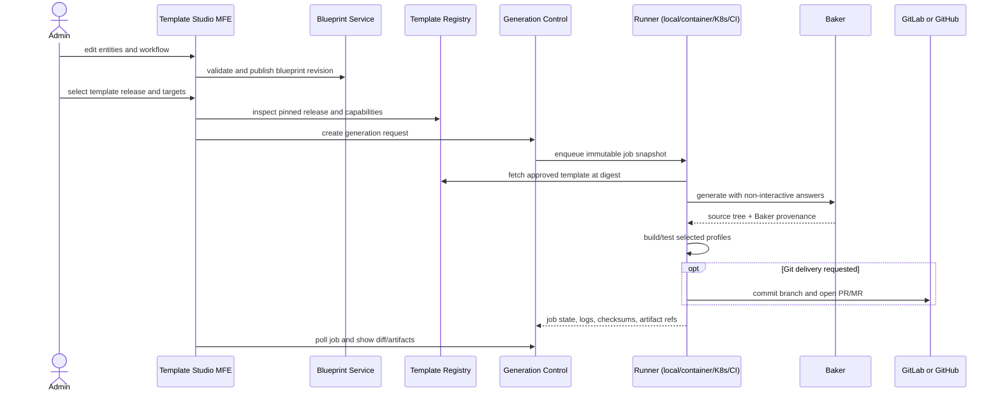

# Template Studio and Application Generation Design

Status: proposal for design review. This document defines the next architecture
slice; implementation should start after the design decisions at the end are
accepted.

## Goal

Add a shell-hosted application for designing application models, workflows, and
reusable Baker templates, then generating reproducible application projects from
those definitions. Generated source must be usable on a developer machine, in
container or Kubernetes runners, and in GitLab or GitHub CI. The generated
application may contain Rust services, admin pages, microfrontend remotes,
WebAssembly components, workflow definitions, and deployment assets according
to the selected template.

Keep Modulaga's service APIs Rust + Axum + ConnectRPC + protobuf. The browser
application is a microfrontend loaded by the existing shell; generated projects
remain independent projects and do not need Modulaga at runtime.

## Reference projects and reusable ideas

### Baker and `saas-templates`

Baker is a Rust CLI that renders a directory template from answers, supports
MiniJinja file and path rendering, non-interactive answer files, hooks, and
records generation metadata. Its `update` command re-renders from saved answers
and marks conflicting user edits, so updates must be presented as a reviewable
diff rather than an invisible overwrite. Hooks execute processes and therefore
make a template a code-execution boundary.

The `dinosath/saas-templates` project is already a strong seed template. Its
`baker.yaml` describes selectable backend, ORM, database, ID, auth, API protocol,
frontend, CI, and deployment options. It accepts an `entities` JSON answer
validated through a schema file. Its Connect entity-editor sample demonstrates
an Axum + SeaORM backend, shared protobuf, ConnectRPC editor, REST compatibility,
and a framework-independent Web Component. The template also includes Rust,
frontend, Docker, Kubernetes, CI, and protobuf templates. Modulaga should
catalog and pin this template rather than duplicate Baker's rendering engine.

### Ferris CMS and TrailBase

Ferris CMS demonstrates a visual content-type builder with collection and single
types, components, relations, dynamic zones, staged changes, undo/redo, and
schema-driven content forms. Its useful lesson is to make entities and fields
first-class versioned domain objects, then derive editing UI and validation from
the schema. Its runtime database DDL and Strapi-compatible REST behavior are
optional generated-app capabilities, not assumptions of the Modulaga control
plane.

TrailBase demonstrates a compact generated/runtime target with schema-driven
APIs, auth, realtime capabilities, an admin UI, and a WebAssembly runtime. Treat
it as an integration or template target and a source of product ideas; do not
couple the Modulaga generator to TrailBase internals or copy its code into the
control plane.

Ferris CMS is the strongest source for entity-builder behavior, but its current
documented runtime API is Strapi-compatible REST and its admin is Dioxus. Use its
domain/UI patterns or extract Rust domain crates. Before any service is exposed
to Modulaga clients, provide the required ConnectRPC protobuf contract; the
shell must not acquire a REST-only backend dependency. Any later TrailBase code
reuse or bundling should first pass its repository license and compatibility
review.

### Ferris Workflow

Ferris Workflow stores and validates Open Workflow Specification (OWS)
definitions, offers a visual editor for common task forms, and keeps a raw JSON
view for the rest of the specification. The service is Axum-based and exposes
ConnectRPC operations. Its current protobuf model includes a workflow `version`
field and its generic entity transport carries the OWS JSON document. Modulaga
should preserve that separation: typed visual editing for common steps,
canonical OWS as the persisted workflow document, and validation against the
OWS model before a version can be published. Published versions must be
immutable; if the existing update operation overwrites a version, add revision
history before using it as a generation input.

Apply the same transport check to Ferris Workflow: its current crate enables
Connect JSON, so an integration must add Connect protobuf support or a Rust
protobuf facade before it satisfies Modulaga's ConnectRPC-with-protobuf rule.
Keep one shared workflow store and editor rather than building a duplicate.

## Product model

Keep four concepts separate so generation stays understandable and
reproducible:

1. **Application blueprint** — the user's application model: project identity,
   entities/content types, field definitions, relationships, pinned workflow
   references, and desired capabilities.
2. **Template release** — an immutable Baker template source and the parameters,
   capabilities, and outputs it supports.
3. **Generation request** — a frozen snapshot of one blueprint revision, one
   template release, answers, and selected build/delivery targets.
4. **Generation job and artifact** — the asynchronous execution record, logs,
   checks, source archive, and any published Git reference or build outputs.

Editing a blueprint or moving a template's default branch must not silently
change an existing generation request. Store immutable revisions or content
digests for all referenced input documents and template files.

### Blueprint and schema model

The blueprint is a versioned JSON document with a JSON Schema envelope. Entity
definitions use a stable, renderer-neutral model inspired by the CMS examples:

- entity kind: collection, singleton, reusable component, or enum;
- field identity, label, type, required/default rules, validation, and optional
  JSON Schema constraints;
- relationship kind and target entity;
- localized, secret, media, and computed-field capabilities only when a target
  declares support;
- schema revision, status, and audit metadata.

The editor should show staged add/change/remove operations, support undo/redo,
and validate references before publishing. Use a typed form model and compile it
to JSON Schema plus target-specific Baker answers. Do not make a database table
the canonical schema: the same blueprint must generate SQL/ORM types, API
contracts, admin forms, and potentially runtime-defined content types.

At the first integration point, map the UI model to the `entities` answer already
used by `saas-templates`. Template capabilities declare which field types,
relations, protocols, database choices, and UI targets are supported. A
template's `baker.yaml` remains authoritative for Baker questions; the
Template Studio reads its question definitions and adds friendly UI metadata
such as grouping, control type, help text, and defaults. Unsupported answers
must fail validation before a job starts.

### Workflows

Store application workflows in a workflow service as versioned OWS documents.
A workflow may be referenced by one or more entities or application features.
The designer offers forms and a graph for common `set`, `call`, `wait`, `emit`,
`switch`, `for`, `do`, and `try` steps, plus a raw JSON editor. Each save
validates the whole OWS document; publishing pins a specific workflow version
into a blueprint revision. The existing Ferris Workflow service is the first
reuse candidate; do not build a second OWS engine alongside it.

Application workflows and generation execution are distinct. OWS describes
behavior that the generated application can run. The generation service owns a
fixed, auditable job lifecycle (validate, render, build, package, deliver); users
cannot add arbitrary shell commands to that lifecycle through workflow JSON.
Templates may declare named, reviewed build profiles, not executable command
strings supplied by a workspace editor.

## Proposed monorepo layout

```text
apps/
  template-studio/               shell-loaded admin MFE
services/
  application-blueprint/         schemas, entities, workflow references, revisions
  workflow/                      existing Ferris Workflow service or adapter
  template-registry/             Baker template sources and immutable releases
  generation-control/            ConnectRPC API, jobs, policies, status
  generation-runner/              Rust worker binary and provider/build adapters
packages/
  blueprint-contracts/            JSON Schemas, TypeScript views, fixtures
  generation-contracts/           protobuf sources and generated clients
workspace-config/
  catalog.json                    publish template-studio as a shell app
  templates/                      local development template fixtures only
```

These are bounded contexts and deployable units, not a requirement to begin with
five network hops. For the first vertical slice, blueprint and template metadata
may share a Rust service process and database schema if their protobuf packages,
domain modules, and storage ownership remain separable. Prefer integrating the
existing Ferris Workflow service over copying it; if its UI cannot satisfy the
shell's MFE contract, keep its Axum/ConnectRPC service and build a thin
Template Studio workflow adapter. The worker must remain an isolated execution
boundary from the CRUD API process.

The existing `workspace-config` service continues to own shell/workspace
configuration. The existing app catalog continues to own microfrontend
releases. Baker templates have a separate catalog because a template source is
not a runnable shell remote. `template-studio` is an independently built MFE,
registered in the app catalog and placed into the admin workspace menu through
`workspace-config`.

## Service responsibilities and ConnectRPC contracts

All service ingress is Axum. Public service operations use generated ConnectRPC
and protobuf contracts. Dynamic model documents can travel as canonical JSON
payloads within typed protobuf request/response envelopes; identifiers,
revisions, job states, target selections, and errors remain explicit protobuf
fields.

### Application Blueprint service

Owns blueprint drafts and published revisions, entity/content-type schemas,
workflow references, cross-reference validation, and audit history. Initial
operations: `GetBlueprint`, `CreateBlueprint`, `UpdateBlueprintDraft`,
`ValidateBlueprint`, `PublishBlueprintRevision`, and versioned entity/schema
operations. Publishing a blueprint revision resolves workflow IDs against the
workflow service and freezes exact OWS revision references with its schemas.

### Workflow service

Reuse the Ferris Workflow Axum/ConnectRPC service as the initial OWS authority.
Its workflow API owns workflow CRUD, normalization, validation, and workflow
revision identity. The blueprint service stores only workflow references. The
Template Studio talks to it through a thin client/adapter; generated app
templates consume exported OWS documents or generated workflow code. If the
service is copied into this monorepo later, preserve its ConnectRPC boundary and
keep its migrations and runtime isolated from the template catalog.

### Template Registry service

Owns the template catalog, source location, immutable release, source digest,
Baker compatibility, trusted publisher, declared capabilities, and input
schema. An administrator can add a GitLab/GitHub/local development source,
select a commit or release tag, inspect a Baker manifest, validate examples,
and publish a template release. User generation always pins an immutable commit
and digest. A movable branch is a discovery alias only.

The registry should support Git sources with credentials fetched at execution
time. It must not persist a working copy as the authoritative template or use a
default branch as an immutable release identifier.

### Generation Control service

Owns `CreateGenerationJob`, `GetGenerationJob`, `ListGenerationJobs`,
`CancelGenerationJob`, `GetArtifact`, and dry-run/validation operations. Job
creation records the exact blueprint revision, template digest, resolved Baker
answers, requested targets, and caller identity. Status is polled through
ConnectRPC in the first version; a future event stream can be added without
changing the job resource.

Suggested job states are `queued`, `validating`, `rendering`, `building`,
`packaging`, `delivering`, `succeeded`, `failed`, and `cancelled`. Each transition
records timestamps and a safe log reference. Retry creates an explicit attempt
under the same request or a new request; it never overwrites a successful
artifact.

### Generation Runner

Runs as a separate Rust worker binary/image. It obtains a pinned job, fetches
approved source snapshots, writes an answer file, and invokes Baker using
argument arrays (never shell interpolation) and `--non-interactive`. It builds
only the declared profiles and uploads a checksummed artifact plus provenance.
The control service does not execute Baker, Cargo, npm, Docker, or template
hooks in its own process.

## Generation and delivery targets

Keep **where a job runs** separate from **where its output goes** and **what it
builds**:

| Dimension | Initial values | Meaning |
| --- | --- | --- |
| Runner | local worker, container worker, Kubernetes Job, external CI runner | Isolation and compute location. |
| Delivery | downloadable archive, approved local output volume, GitLab branch/MR, GitHub branch/PR | Destination for generated source. |
| Build profile | checks, native service, OCI image, Kubernetes manifests, WASM, MFE assets | Outputs compiled or packaged from generated source. |

Local generation produces an artifact archive by default. Writing into a host
directory requires a specifically configured output root mounted into the local
runner; users cannot submit arbitrary server paths. The container profile runs
one ephemeral container per job. The Kubernetes profile creates a constrained
Job with resource limits, deadline, service account, and short-lived artifact
credentials. The CI profile ships a small Rust `modulaga-runner` command and
GitHub Actions/GitLab CI examples that request a pinned job over ConnectRPC,
generate/build it in that provider's runner, then report artifact metadata.

Git delivery is handled by provider adapters. The first provider operation
should create a branch and commit generated files into a user-selected existing
repository, then optionally create a pull request or merge request. Creating a
new repository can follow as a separate permission and UX step. Tokens use
Ferriskey-backed OIDC plus provider installation/OAuth credentials held by a
secret store; never place credentials in Baker answers, generated source, job
logs, or browser storage.

Building WASM or MFE assets does not automatically make them mountable in the
current shell. A generated remote must publish a compatible Modulaga app
descriptor and pass the existing app-catalog approval/install flow. WASM output
needs a separately reviewed shell adapter and a defined host ABI; until those
exist, generation can return the WASM artifact without installing it.

## Execution flow



## Security and trust boundaries

Templates and Baker hooks are executable inputs. Only administrators can
register or publish them. Registry releases must have a pinned commit and
content digest, source allowlist, declared hook policy, and publisher identity.
An untrusted template is inspect-only until approved. A job worker runs with no
host socket, no ambient cloud credentials, bounded CPU/memory/time/output, a
unique temporary workspace, and deny-by-default network access. Any needed
dependency downloads go through configured package mirrors or a narrowly
allowlisted egress policy.

Ferriskey roles gate schema editing, template administration, publishing,
generation, and external delivery independently. The runner receives a
short-lived job capability scoped to one generation request. Git provider tokens
are scoped to the chosen repository and operation. Logs redact secrets and
truncate unbounded tool output. Cancellation terminates the child process and
cleans temporary files.

Generated microfrontend code is trusted application code and executes with the
shell page's browser privileges. Catalog publication and workspace installation
remain separate approvals. Generated code cannot self-install into a Modulaga
workspace merely because it was successfully built.

## Storage and reproducibility

- PostgreSQL stores blueprint/template metadata, revisions, job state, and
  audit records, following the existing service deployment pattern.
- The template registry stores remote source identity and immutable digest;
  local template directories are development fixtures only.
- A configurable artifact store keeps source archives, build outputs, diffs,
  and logs with checksums and retention policy. Local Compose may use a mounted
  volume; shared deployments can use an S3-compatible object store.
- Each artifact includes a machine-readable provenance file: blueprint and
  workflow revisions, template commit/digest, Baker version, resolved
  non-secret answers, build profile, toolchain/image digest, and checksums.
- Generated repository metadata includes Baker's generated-file record and a
  Modulaga manifest linking to the originating blueprint and job. Template
  upgrades use `baker update` only in a review branch and surface Baker conflict
  markers as a diff for resolution.

## Rollout plan

### Phase 0: contract and design freeze

Agree on the blueprint schema, OWS version, template release model, and the
meaning of local/Git/CI targets. Add example fixtures and threat model before
service code.

### Phase 1: local generation vertical slice

Add the Template Studio MFE with template browsing, an entity editor for a
small set of scalar/JSON/relation fields, workflow metadata plus raw OWS JSON,
and a generation wizard. Register one pinned `saas-templates` release. Generate
one Axum + PostgreSQL + ConnectRPC + entity-editor app using the local isolated
runner, run its existing build/tests, and return an archive with a reviewable
file list. Do not enable arbitrary template hooks in the first fixture.

### Phase 2: versioned editing and job history

Add draft/published blueprint revisions, schema diff/undo, visual workflow
editing, generation history, artifact retention, and Baker update previews.

### Phase 3: container and Kubernetes execution

Publish a pinned runner image, add per-job container execution, then Kubernetes
Jobs with resource and network policies. Keep the local runner usable for
offline development.

### Phase 4: Git provider delivery and CI runner

Add GitHub and GitLab provider adapters, branch/commit plus optional PR/MR, and
documented GitHub Actions and GitLab CI runner examples. Exercise credentials,
OIDC, retries, cancellation, and cleanup against provider test repositories.

## Verification gates

- Unit/property tests validate blueprint relationships, schema migration,
  workflow OWS, Baker answer mapping, permission checks, job transitions, and
  provenance hashes.
- Runner tests use a fake Baker and fake Git providers; they verify safe
  argument passing, cancellation, failure logs, cleanup, retry isolation, and
  no credential leakage.
- Contract tests verify generated protobuf clients and compatibility of
  versioned JSON payloads.
- Browser tests cover schema editing, OWS/raw-view synchronization, invalid
  reference feedback, a live generation job, and artifact/diff inspection.
- Preserve the requested >=90% coverage gate for business logic and contracts.
  Add separate integration tests for real Baker rendering, PostgreSQL, Docker,
  Kubernetes, and provider APIs; do not count those infrastructure adapters as
  untested business logic.

## Decisions for design review

Recommended defaults are listed so the next implementation step can be
assigned without rediscovering the architecture:

1. Use a renderer-neutral blueprint schema with JSON Schema validation, then
   translate into Baker answers. Do not make Baker's question YAML the canonical
   source for the entity model.
2. Use versioned OWS for generated application workflows; keep generation job
   execution in the fixed Generation Control state machine.
3. Start with local isolated Baker generation and downloadable artifacts.
   Enable hooks only for trusted template releases after runner isolation exists.
4. Add Git delivery as branch + commit to an existing repository first, then
   optional PR/MR. Treat full repository creation as a later privilege.
5. Support `saas-templates` as the first compatibility fixture. Treat Ferris CMS
   and TrailBase as inspirations or separately registered generation targets,
   not required runtime dependencies.

## Sources

- [Baker](https://github.com/aliev/baker) — CLI template format, answers,
  hooks, generation metadata, and update behavior.
- [SaaS Baker templates](https://github.com/dinosath/saas-templates) —
  selectable stack options, entity answer schema, Connect editor, and build
  templates.
- [Ferris CMS](https://github.com/dinosath/ferris-cms) — content-type builder,
  staged schema changes, relations, and generated/runtime schema behavior.
- [TrailBase](https://github.com/dinosath/trailbase) — schema-driven backend,
  admin, authentication, realtime, and WebAssembly product direction.
- [Ferris Workflow](https://github.com/dinosath/ferris-workflow) — OWS
  persistence/validation, ConnectRPC API, visual task editor, and raw JSON view.
- [Current Modulaga shell architecture](architecture.md) — workspace,
  application catalog, and service boundaries to preserve.
