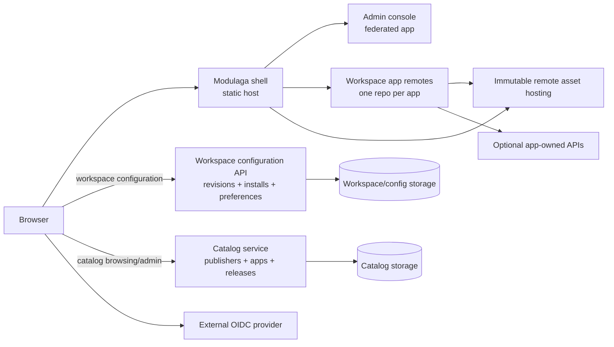
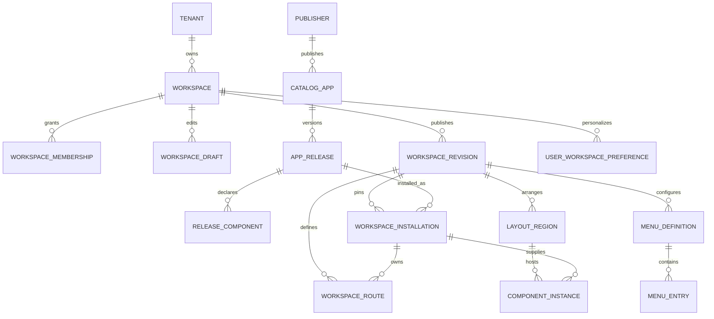

# Modulaga Architecture And Microservices Plan

> Superseded design draft. The implemented direction is documented in [the current architecture](../architecture/architecture.md).

**Status: Proposed for owner review. No implementation is authorized by this document.**

This proposal defines deployable boundaries for independently delivered Modulaga
apps, workspace-specific configuration, and shared platform services. It does not
replace `plan.md`, freeze API contracts, or authorize changes to
`../modulaga-config-api` or its source template.

## 1. Recommendation

Use two platform backend services plus independently deployable frontend apps:

1. **Modulaga shell**: the static host application. Owns top-level routing,
   workspace bootstrap, trusted remote loading, and lifecycle management.
2. **Admin console**: a separately deployable federated app for catalog and
   workspace administration. It uses registered views and shared platform
   contracts; it does not inject arbitrary UI code.
3. **Each customer/product app**: its own repository and independently versioned
  remote release. A separate app-owned backend is optional and belongs to that
  app only when its business domain needs one.
4. **Modulaga catalog service**: owns publishers, app identities, immutable
  releases, and release component descriptors. It has no workspace/user state.
5. **Modulaga workspace configuration API**: owns tenants/workspaces, membership
  references, published configuration revisions, installation pins, menus,
  layouts, component placements, admin navigation configuration, and permitted
  user preferences.

Do **not** create a microservice for every UI app, menu, component, or theme. An
app backend is a service only when the app has a genuine business domain and
independently owned data. Do not create one BFF per backend service. This proposal
chooses a distinct catalog service because publisher/release lifecycle and
workspace configuration are separate ownership and data domains. The transport
and gRPC/template implementation are explicitly out of scope here.

Identity should be provided by an external OIDC provider. Authorization remains a
server-side responsibility in Modulaga's API; UI visibility is not authorization.

## 2. Evidence And Current-State Constraints

The current shell calls HTTP/JSON endpoints at port 4303 from
`apps/shell/src/workspace/api.ts`. Its root run scripts and Playwright setup still
reference the old `apps/config-api` path. That directory is absent after the
move.

The sibling `../modulaga-config-api` is a generated Rust service with workspace,
application, and menu-entry CRUD models. It does not currently model publishers,
immutable catalog releases, revision-pinned installations, configuration
revisions, user preference overlays, or admin navigation. Its generated data
models need cardinality changes before they can represent multiple applications
per workspace or multiple menu entries per application. Transport implementation
is owned by the service template and is not a decision in this proposal.

The existing JSON Schemas already contain draft shapes for catalog apps/releases,
workspace installations, routes, menus, component instances, themes, preferences,
and admin navigation. They are not yet consumed by the services and should be
reconciled with the logical model below before either service exposes a stable API.

## 3. Target Topology



Data flow at startup:

1. Browser authenticates through OIDC. The browser receives a secure session
   through the web-facing HTTP boundary, not a long-lived service credential.
2. Shell requests the effective configuration for the selected workspace.
3. The API returns the published workspace revision plus only the requesting
   user's authorized preference overlay and capability summary.
4. Shell resolves enabled menus, installed apps, and approved component slots.
   It loads a pinned immutable remote release only when selected/needed.
5. A remote app calls its own app API when it has backend behavior. It does not
   receive platform database credentials or direct access to other apps' data.

## 4. Repository And Deployment Boundaries

| Deployable/repository | Owns | Initial status |
| --- | --- | --- |
| `modulaga` | Shell, local demo remote, platform contracts during early development, browser acceptance harness | Keep as the platform integration repo. The shell remains independently buildable/deployable. |
| `modulaga-config-api` | Tenant/workspace configuration, memberships, drafts/revisions, app installations, navigation/layout/component placements, preferences, and admin-navigation config | Existing sibling. Evolve it into the workspace configuration service; change generated models/cardinality before production use. |
| `modulaga-catalog-service` | Publisher records, app identities, immutable app releases, component descriptors, compatibility and approval metadata | New platform backend service/repository in the target design. It owns no workspace installations or user preferences. |
| `modulaga-admin` | Admin UI for catalog, workspace configuration, and its own registered navigation | Separate federated app/repo when its independent release is useful; it is not a backend microservice. |
| `modulaga-app-<name>` | One independently versioned app remote; app-specific UI and optional app API | Create per actual app, not as empty starter repos for hypothetical services. |
| App-owned backend (optional) | One product app's domain operations and data | Create only when that app requires server-side business behavior. Keep its API/data ownership with that app; do not create a backend just because its UI is a remote. |
| `modulaga-contracts` | Versioned lifecycle/configuration schemas and generated client types | Keep in the current workspace initially. Publish versioned packages before extracting a new repository. Not a service. |
| External OIDC tenant | User authentication and identity lifecycle | Prefer managed/existing identity provider; do not build an identity microservice. |

A separate repository does not necessarily mean a separate backend. A remote app
can be a static artifact and use no backend. If it needs domain APIs, the app team
owns those APIs and their data. Shared deployment/hosting may serve multiple
immutable remotes; independent versioning and rollback matter more than a separate
server process for every app.

## 5. Service Responsibilities And Data Ownership

### Configuration/control-plane API
### Catalog service

Owns:

- Publisher and ownership metadata, including publication approval state.
- Stable app identities and immutable release records.
- Release descriptors: version, manifest/exposed module, integrity/provenance,
  lifecycle and shell compatibility, required capabilities, routes, and declared
  component definitions/settings schemas.
- Release lifecycle such as submission, approval, publication, deprecation, and
  withdrawal. Published artifact metadata is immutable; lifecycle state may
  change without rewriting the artifact descriptor.

It owns metadata, not executable hosting. Remote bundles remain immutable assets
hosted independently. It owns neither workspaces nor app business data.

### Workspace configuration API

Owns:

- Tenant/workspace records and workspace membership references to external OIDC
  subject IDs. It does not own passwords, authentication sessions, or the global
  identity directory.
- Draft/published workspace configuration and immutable revision history.
- Revision-scoped app installations that pin one exact catalog release, route
  base, and validated install settings.
- Workspace menus, routes, layout regions, placements, theme references, and
  admin-navigation configuration.
- Per-user/per-workspace preference overlays for allowlisted presentation and
  personalization fields.
- Authorization using verified caller identity plus tenant/workspace membership
  and role/capability policy.

At install/upgrade time, it validates a release with the catalog service and
persists the exact release ID plus an immutable descriptor snapshot needed for
that workspace revision. This avoids a live catalog lookup for every shell
bootstrap while preserving catalog ownership of release truth. There are no
cross-service database joins or shared tables.

Catalog and workspace configuration are separate backend services from the first
production architecture. Keep each service internally modular; do not split
catalog into per-publisher, per-app, or per-release services.

### App-owned APIs

Optional and domain-specific. Each app owns its API contract, authorization scope,
data store, and operational lifecycle. No shared Modulaga service should become a
place to store app-specific business data.

### Shared packages and styles

Contracts, DOM lifecycle SDK, and theme tokens are versioned packages, not runtime
microservices. Workspace theme configuration selects a published theme/token
version and allowed palette/density settings. Do not persist or execute arbitrary
CSS or JavaScript from a workspace/user preference.

## 6. Configuration Scope: Menus, Components, And Styles

Use a layered effective configuration:

```text
Effective UI = published workspace revision
             + permitted user/workspace preference overlay
             + current authorization policy
```

- **Workspace baseline**: workspace admins configure shared navigation tree,
  installed releases, approved component placements, and theme preset. Changes
  are drafted, validated, previewed, and published as revisions.
- **Personal menu**: users may hide/reorder only entries enabled by workspace
  policy. They cannot create routes, add uninstalled apps, or bypass permissions.
- **Personal components**: users may configure only registered component
  instances/slots explicitly marked personalizable. Settings are validated against
  the component schema; authorization is checked independently.
- **Styles**: admins may choose an approved brand/theme token set. Users may choose
  among allowed appearance options (for example density or light/dark preference).
  No free-form CSS, script, remote stylesheet URL, or permission-bearing theme.
- **Admin navigation**: separate from end-user workspace menus. It is composed from
  registered admin views and is scoped to the platform or tenant/workspace admin
  context. A node can point only to a registered view the current user may access.

The API should resolve the user's current permissions on every protected read or
write. A saved personal preference is presentation state, never a capability grant.
At first, personal overrides are limited to hiding/reordering allowed menu
entries, favorites, allowed appearance choices, and arranging/configuring only
workspace-enabled personalizable component definitions. Users cannot install
apps, add arbitrary routes, select unpublished releases, or inject CSS/JS.

### Proposed logical data model

Models are divided by service ownership. IDs crossing a service boundary are
stable opaque identifiers; no database foreign keys cross service databases.

#### Catalog service

| Model | Important fields | Relationships and rules |
| --- | --- | --- |
| `Publisher` | `publisherId`, display name, verified origins, publication state | One publisher owns many catalog apps. Approval state is server-controlled. |
| `CatalogApp` | `appId`, `publisherId`, slug, name, description, tags, icon metadata | One app has many releases. `appId` is stable and global; an app is not an installation. |
| `AppRelease` | `releaseId`, `appId`, semantic version, immutable descriptor, manifest URL, integrity/provenance, compatibility, capabilities, lifecycle state | Unique `(appId, version)`. Published descriptor/assets cannot be overwritten. Release ID is what a workspace pins. |
| `ReleaseComponent` | `releaseId`, `componentId`, exposed module, settings schema ID, required capabilities, personalizability policy | One release declares zero or more component definitions. Definitions are part of the immutable release; there is no component service. |

Publisher submission/approval and release lifecycle (draft, approved, published,
deprecated, withdrawn) belong here. A release descriptor declares routes and
components, but the catalog does not own workspace menu placement or app business
data. Static remote assets are hosted independently.

#### Workspace configuration service

| Model | Important fields | Relationships and rules |
| --- | --- | --- |
| `Tenant` | `tenantId`, name, status | One tenant owns many workspaces. Tenant scope is mandatory on workspace reads/writes. |
| `Workspace` | `workspaceId`, `tenantId`, name, current published revision pointer | One tenant owns many workspaces. A workspace has drafts and immutable published revisions. |
| `WorkspaceMembership` | `workspaceId`, external OIDC `issuer` + `subject`, role/capability assignments, status | Many-to-many between workspaces and identity subjects; unique `(workspaceId, issuer, subject)`. Credentials and identity directory remain external. |
| `WorkspaceDraft` | `draftId`, `workspaceId`, base published revision, mutable config document, version/ETag, editor subject, update time | Optimistic concurrency prevents lost updates. Start with one current draft per workspace; support collaborative drafts later without changing published revision semantics. |
| `WorkspaceRevision` | `revisionId`, `workspaceId`, monotonic revision number, immutable config snapshot/hash, parent revision, publisher subject/time | One workspace has many published revisions; unique `(workspaceId, revisionNumber)`. Rollback publishes a new revision based on an older snapshot. |
| `WorkspaceInstallation` | `installationId`, `revisionId`, `appId`, exact `releaseId`, route base, install settings, descriptor snapshot | A revision contains zero or more installations. Initially, at most one release of an app per workspace revision. Upgrade changes the pin in a new revision; history retains old pins. |
| `WorkspaceRoute` | `routeId`, `revisionId`, `installationId`, path/template, route metadata | Routes belong to one revision and installation. IDs remain stable where possible; paths are unique within a revision. |
| `MenuDefinition` | `menuId`, `revisionId`, name, scope | A revision may define multiple menus. Workspace menus define the shared baseline. |
| `MenuEntry` | `entryId`, `menuId`, optional `parentEntryId`, type (`group`, `route`, `external`), label, target, order | Entries form a nested tree. Sibling order is unique within `(menuId, parentEntryId)`, not globally. Route entries reference a `WorkspaceRoute`; external URLs are validated. |
| `LayoutRegion` | `regionId`, `revisionId`, layout template, order/breakpoint | A revision has one bounded layout template and named regions; no arbitrary page-builder schema. |
| `ComponentInstance` | `instanceId`, `revisionId`, `installationId`, `componentId`, `regionId`, order, settings | A region has zero or more instances. The component must be declared by the installation's pinned release; settings validate against its schema. |
| `WorkspaceThemeRef` | `revisionId`, immutable `themeId` + version, allowed theme settings | Zero or one base theme per revision. Theme assets are versioned packages, not a theme microservice. |
| `UserWorkspacePreference` | external `issuer` + `subject`, `workspaceId`, allowlisted overrides, version | At most one active preference document per user/workspace. Presentation state only; no access grants or copied workspace configuration. |
| `AdminNavigationRevision` | deployment/tenant scope, revision, tree of groups/view links, registry version | Separate from workspace menus. Links reference views registered by an approved admin app release, never arbitrary component URLs. |

The published `WorkspaceRevision` is the consistency boundary: it captures menus,
routes, layout, theme, component instances, and exact installation release pins
as one validated snapshot. Draft edits do not mutate the published revision. The
service may normalize revision-owned collections into child tables, but every
child must be scoped to a revision and publication must be atomic.

#### Relationships



The `APP_RELEASE` to `WORKSPACE_INSTALLATION` edge is a logical reference by
`releaseId`, not a cross-database foreign key. Catalog validates the release at
install/upgrade time. Workspace configuration stores the exact release ID and an
immutable descriptor snapshot so bootstrap does not depend on a live catalog
lookup.

#### Changes from the current generated entities

- Move `manifest_url`, `remote_name`, `exposed_module`, integrity, compatibility,
  and release version out of mutable workspace `Application` data and into
  immutable `AppRelease` metadata owned by Catalog.
- Keep workspace-specific `routeBase`, install settings, and the exact release
  pin on `WorkspaceInstallation`; an app identity is not itself installed.
- Replace the current unique `Application.workspace_id` constraint with a
  revision-scoped one-to-many installation relation. Multiple apps must be
  installable in the same workspace.
- Replace the unique `MenuEntry.application_id` relation with menu entries
  targeting routes. One route/app may be referenced from multiple entries/menus;
  groups and external links need not reference an app.
- Replace globally unique `MenuEntry.position` with sibling ordering scoped to a
  menu and parent. Keep stable entry IDs so personal overrides survive harmless
  label/reorder edits.
- Add tenant membership, drafts/revisions, routes, layout regions, component
  instances, theme references, preferences, and separately scoped admin
  navigation. These are absent from the generated CRUD entities today.
- Align `packages/contracts/src/schemas/` with this model before treating the
  schemas as canonical: include tenant/revision references, component preference
  overrides, component personalizability policy, and the release snapshot boundary.

### Independent app/repository model

An independently deployed app is not synonymous with a microservice. Each app
repository owns its remote UI, stable `appId`, release descriptor, route and
component declarations, app-local scoped styles, compatibility declaration, and
build/release pipeline. It may contain only a static remote, or optionally include
one or more app-owned backend services when the product has server-side domain
behavior and data. Those backends own only that app's data and APIs.

Apps do not own workspace menus or mutate workspace configuration directly.
Workspace admins place app routes/components through the workspace service. The
catalog decides whether a release is approved; the workspace service decides
whether an authorized workspace pins it. App styles must be scoped and consume
approved shared tokens; global page CSS is not an app capability.

## 7. Browser Boundary And BFF Decision
## 7. Transport Boundary
Transport implementation (including gRPC, HTTP, or a generated browser adapter)
will be resolved through the service template and is not part of this domain
design. Preserve the service ownership and model boundaries in this document
regardless of transport. Do not add one BFF per backend; any later frontend
adapter must not replace authorization in the owning domain service.

## 8. Remote App Contract And Trust

Each app repository builds an immutable remote release and publishes a descriptor
containing stable app ID, release ID/version, publisher, federation entry/exposed
module, lifecycle contract version, minimum shell version, capabilities, styling
compatibility, and integrity/provenance metadata. A workspace installation pins
one exact release; an upgrade is an explicit config revision. Uninstall removes
the workspace association, not the catalog release.

Federated JavaScript runs with the host page's privileges; Module Federation is not
a sandbox. Only trusted/approved publishers and immutable origins may be enabled.
The shell loads installed releases on demand and owns browser history/lifecycle.
An app owns paths below its assigned base route and its own backend, if any.

## 9. Delivery And Operations Boundaries

- Shell and remote apps deploy as static immutable assets with independent release
  and rollback. Remote manifest/public path and CORS must work from the deployed
  shell origin.
- Configuration API (and optional BFF) deploy as versioned services with health
  probes, structured logs, metrics, resource limits, secrets supplied at runtime,
  and migration/rollback strategy.
- Database ownership is service-local: configuration API owns workspace/catalog
  metadata; an app API owns only its domain data. No cross-service database joins.
- Changes to shared contracts are versioned and backward-compatibility checked.
  Shell advertises supported contract versions; incompatible remote releases are
  rejected before activation.
- CI/CD provider and hosting remain undecided; this plan specifies deployment
  units, not a cloud vendor or cluster topology.

## 10. Phased Implementation Plan

### Phase A: Architecture approval

- Approve the Catalog versus Workspace Configuration service boundary and whether
  admin is a separate remote/repository.
- Confirm tenant/workspace and user override scope, identity provider boundary,
  release trust policy, and app backend ownership.
- Confirm the canonical Baker template/source repo for generated API changes.

### Phase B: Stabilize the configuration service

- Establish separate Catalog and Workspace Configuration service data ownership,
  API contracts, repositories, migrations, and service-to-service authorization.
- Fix data cardinalities: many apps per workspace; many menu entries per route;
  menu ordering unique within its owning menu/parent, not globally.
- Separate `CatalogApp`, immutable `AppRelease`, and revision-scoped
  `WorkspaceInstallation`; model tenant membership, workspace revisions, and
  user preference overlays separately.
- Add validated authorization at each service method/HTTP route. `authentication:
  jwt` in generation answers is not proof of enforced authorization; verify
  interceptors/middleware and deny cross-tenant access.
- Add revision/conflict semantics before exposing edit/publish flows.
- Generate changes from the agreed template or document why a generated-file
  customization is necessary, then regenerate and test.

### Phase C: Browser integration

- Implement the selected HTTP boundary and map stable HTTP errors/contracts to
  the Solid shell and admin remote.
- Replace stale local paths/scripts only after the API transport and run contract
  are agreed.
- Add browser tests for workspace bootstrap, user-specific menu/preferences,
  admin changes, authorization failures, and remote load/version mismatch.

### Phase D: Independent apps and catalog

- Publish the first sample app from its own repository and validate the release
  descriptor, immutable deployment, compatibility, install, pin, upgrade, and
  rollback flow.
- Implement publisher/release lifecycle in Catalog and workspace pins/revisions
  in Workspace Configuration; verify no cross-service database ownership leaks.
- Create app-specific backend services only for apps with independently owned
  business data/operations.

## 11. Proposed Acceptance Checks

- A workspace admin can publish a menu/component/theme baseline without changing
  another workspace.
- Two users in one workspace can have permitted different menu visibility/order
  and appearance, while unauthorized entries remain inaccessible by direct URL/API.
- A pinned app release remains stable until an explicit upgrade revision is
  published; rollback restores the prior config/release pin.
- A remote app can build and deploy from its own repo and load through its
  descriptor; no host rebuild is needed for an approved release update.
- No browser receives internal gRPC credentials; BFF/API direct requests enforce
  the same access rules.
- Database constraints support the stated cardinalities and tenant scoping.
- The generated config service is reproducible from its approved template and its
  generated API passes authorization, integration, migration, and contract tests.

## 12. Approval Questions

1. **Service split:** Approve separate Catalog and Workspace Configuration
  backend services, with Catalog owning publishers/apps/releases and Workspace
  Configuration owning installations and user/workspace settings?
2. **Personalization:** Should individual users be allowed to hide/reorder workspace
   menu entries and choose from approved components/themes, with workspace admins
   retaining control of availability?
3. **Admin app:** Should the admin console be its own federated app/repository, or
   stay inside `modulaga` until its first independent deployment is needed?
4. **App installations:** Should a workspace initially allow only one pinned
  release per app, or should it allow named parallel installations of the same
  app/release?
5. **Generation source:** Confirm the canonical source/template repository for
   `modulaga-config-api` before any model or transport changes are implemented.
6. **Identity:** Which existing OIDC provider/tenant should be used? Until chosen,
   production authorization and deployment remain blocked.

## 13. Deliberately Not Proposed Yet

- A microservice for menus, themes, components, preferences, or every app.
- One BFF per backend service.
- A homegrown identity provider, service mesh, message broker, or Kubernetes setup.
- Arbitrary user CSS/JS, untrusted plugin sandboxing, or dynamic source injection.
- A backend service for a frontend app that has no server-side business behavior.
